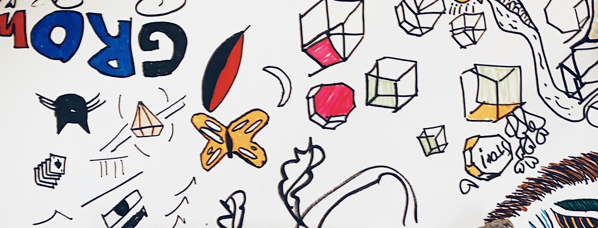

# **Reflective Journal** for *Frid Wright*

*The purpose of this journal is to reflect on my prototyping work for CART 253.*

1. ### <u>First Journal Entry</u> *14/09/2026*
 Using the Markdown ["Cheat Sheet"](https://www.markdownguide.org/cheat-sheet/) made creating and formatting the README much more straightforward than I had originally assumed. Just like learning any other language, I assume it's done by immersion and practice. I spend all weekdays at a language school, so I have confidence that I will be able to sychronously learn another by applying my time... my brain is already in that mode anyway, might as well try to capitalize on that flow. Memorization to reach fluency may prove a challenge, but "do by doing" and all will follow, yes?
 
 In addition to Markdown, getting used to GitHub and it's *staging, committing*, and *pushing to origin* steps seems very manageable. I also appreciate using a single unified repository for all future coursework. Having everything centralized in one place makes the whole development cycle feel organized.
 
 My goal for this course is to build something interesting, functional, maybe even cool, however simple the final product may be. The beginner simplicity may elicit an intial internal struggle due to not being able to actualize my artistic intentions into code, as I am used to more flowery freeform mediums. Will focus more on function and design, over beauty, to start. *Let's see*!
 
2. ### <u>Second Journal Entry</u> *28/09/2026*
This journal entry reflects on my process across the three drawings created for the [Prototyping: Instructions assignment.](https://github.com/FridWright/cart253/blob/main/prototyping-instructions.md) 

My first drawing, *Lime Balls*, was an exercise in basic shapes, fill colors and text, which I hope to build on later by adding bouncing physics to the lime/lemon balls. 

My second drawing, *Quadrant*, focused on spatial symmetry and canvas partitioning with rect(), creating concentric circles, and practicing the use of positioning variables (width / 2, height / 2). In a future edit, I want to make it interactive by swapping quadrant colors based on mouse movement or an audio. 

My third drawing, *Night Waves*, was the most technically complex, and I utilized many references from the p5.js library to create a sea/sky scape. I used paletteLerp() for sky colour transitions, noise() for animated lower waves, and randomSeed() to lock a flickering starry sky in place without the flickering. In the future, I want to explore custom vector geometry using vertex() and bezierVertex() to draw a true crescent moon -*along other more complex shapes*- for all these drawings. 

3. ### <u>Third Journal Entry</u> *30/09/2026*
This journal entry reflects on my process of the [Prototyping: Variables assignment.](https://github.com/FridWright/cart253/blob/main/prototyping-variables.md)

My first prototype, *Stereo Rings*, features a pulsing visualizer built from nested concentric circles that continuously expand and contract. I used animation variables (coreSize, pulseSpeed, minSize, maxSize) with directional boundary checks (if (coreSize > maxSize || coreSize < minSize)) to create the pulsing loop. Proportional multipliers (0.75, 0.5, 0.25) scale the inner ellipse() rings dynamically, while dist() calculates cursor proximity to expand the outer stroke aura (auraSize) when the mouse hovers nearby.

My second prototype, *Tether*, is a follower circle connected to the mouse cursor by a visual tether that lags behind and reacts dynamically to movement speed. I implemented smooth delay using linear easing math (followerX += (mouseX - followerX) * easing), calculated mouse-to-follower distance with dist(), and used line() for the connecting tether. The follower (ellipse()) dynamically inflates in size based on distance while changing color from white to purple using map() and lerpColor(). 

The third prototype, *Bloom*, is an interactive growth sketch where a flower sprouts and blooms when watering the pot. It is built using variables (flowerY, petalSize) modified inside mousePressed() upon clicking the pot's quad() collision area, noCursor() combined with custom triangle() and ellipse() shapes for the water-drop cursor, and layered ellipse() shapes for proportional petal expansion.

Throughout the *Prototyping: Variables* Assignment, I relied heavily on p5.js references and found it essential for implementing functions like dist(), lerpColor(), and mousePressed().

4. ### <u>Fourth Journal Entry </u> *07/10/2026*
This journal entry reflects on my process of the [Prototyping: Conditionals assignment.](https://github.com/FridWright/cart253/blob/main/prototyping-conditionals.md)

My first prototype, *Match Game*, is a classic pair matching game where the user tries to flip cards to find colour matches. I used mousePressed() and dist() to detect player clicks on individual grid cards, triggering a flipped state for revealed colours. For the core memory logic, I utilized setTimeout() to pause face-up cards before flipping mismatched pairs back over. Conditionals were very essential evluating matchs, keeping cards flipped up if so or fipping them back facedown if not. 

My second prototype, *Crosswalk*, is a simulation that relies on conditional logic to govern state transitions, visual rendering, and pedestrian movement. If/else drives the traffic light state machine through red/green/yellow/grey in accordance to timing rules designated. Conditional checks also govern pedestrian behavior by evaluating whether a red or yellow light requires stopping at the crosswalk line, preventing bunching by checking distances against walkers ahead, and cleaning up characters once they move off-screen.

The third prototype is *Ghosts*, uses conditionals to tell a group of curious ghosts whether its safe to approach a lamp they are interested in haunting, based on whether or not its illuminated by the user (..they are scared of the light). If the lamp is switched on, the ghosts hang back in the corner of the screen and are red and angry. Elsewise, when the lamp is off, the ghosts travel down to check out the lamp and are white and at ease. The lamp being on or off also triggers other rules regarding the state of the surrounding environment. 

5. ### <u>Fifth Journal Entry </u> *21/10/2026*
This journal entry reflects on my process for the [Prototyping: Events assignment.](https://github.com/FridWright/cart253/blob/main/prototyping-events.md)

The theme for these prototypes took on an arcade theme as they progressed, and I realized I was doing my renditions of classic games. I suppose that these classic are a good vessel in which to explore Events.

My first prototype *Timed Match Game* is actually a reworking of the week prior's prototype *Match Game*. The changes to this reworked edition include the randomization of the cards with each new reloaded game, so that the matches are not in the same place each time. This was done by putting all the colours in an array to be randomized. A timer was also introduced, adding an element of challenge that prompts the user to find all matches before timer is out. A game over screen has also been added, to ask the user if they want to play again, after they either win or lose. I also added audio to this prototype, which gave me trouble at first and was gratifying to resolve. 

The second prototype, *Twister*, is a reimagiing of the classic board/body game Twister, except it asks the user to keep their fingers on certain keys as opposed to hands/feet on coloured circles on a mat. Event listeners were added to track multi-key holds, so when the keys were held, the game could keep the wheel spinning automatically and not trigger timeout, as well as be aware of what keys are already pressed so as to not call them again. An array of a database of keyboard letters A-Z and numbers 1-9 was created to track keys pressed by assigned a numerical code to each key. 

The third prototype, *Paddleball*, was inspired by the similar in-class assignment. This is a simple paddleball game that utilizes user input events, temporal triggers, and collision physics. Continuous key polling is used for dual-paddle movement, while discrete listeners (keyPressed) handle game-state transitions via the spacebar. Time-based events tracked through millis() automatically introduce new balls at regular intervals, and physics-based collision and out-of-bounds triggers manage ball trajectories and game-over states.

6. ### <u>Sixth Journal Entry </u> *30/10/2026*
This journal entry reflects on my process for the [Prototyping: Functions assignment.](https://github.com/FridWright/cart253/blob/main/prototyping-functions.md)

My first prototype created for this assignment is the *Noise Machine*. Noise machine is designed to look like an old-school synth pad, and works by having the user click buttons on the 4x4 grid pad to play corresponding audio. The prototype uses p5.js lifecycle functions (setup, draw, mousePressed) alongside custom parameterized functions like drawButton() and drawSimpleKnob() which was used to try and keep the code organized. I started by calculating layout coordinates and assigning audio files to each button in a grid. During execution, the program continuously renders the visual interface, which features hardware-esque border, typography, amp knobs, and the interactive buttons themselves.

The second prototype is *M.A.S.H.*, which is originally a pen-and-paper game from my childhood where we are told our future through the process of elimation by tally ticks. This re-imagining gets there instead by random(), return statements and other p5.js functions. The prototype uses specialized helper functions with return statements to pull together random future predictions. When you hit the spacebar, a physics-based wheel spins around using translate, rotate, and arc. Once friction slows it to a stop, the app switches states and calls drawMashCard() to display your new destiny on a retro arcade style card.

My third prototype, *Aquarium*, is a simulation of an aquarium where the user watches colourful swim by peacefully, but when the spacebar is pressed, an event is triggered where a shark swims across the screen and the fish swim faster til he's gone. The code relies on modular functions like updateAndDrawFish(), drawAbstractFish(), and drawGiantShark() to separate motion physics, screen boundaries, and geometric drawing, in the spirit of *refractoring* and keeping an neatly code. 

7. ### <u>Seventh Journal Entry </u> *06/11/2026
This journal entry reflects on my process for the [Prototyping: Arrays assignment.](https://github.com/FridWright/cart253/blob/main/prototyping-arrays.md)

My first prototype is *Night Adaptation*, a piece exploring how our eyes adjust to darkness. Two almond-shaped eye portals act as windows into a night sky, where, over time, an array continuously accumulates custom star objects with randomized spatial coordinates, sizes, and twinkle frequencies to simulate the eye slowly adjusting to low light. Hitting the spacebar triggers a top-to-bottom blink animation that clears the array, resetting the viewer's virtual vision to readjust again.

*Apples*, the second prototype, plays with spatial grid layouts and real-time mouse interaction. A single array stores a 12x12 grid of 144 apple objects across the canvas. As the mouse cursor moves across the canvas, proximity calculations (dist()) evaluate mouse coordinates against each element in the array to dynamically mutate the targeted apple's color property to a randomized RGB value. Pressing the spacebar iterates through the array to reset all object color properties back to the baseline red.

My third prototype is *The Resort*, which is a 4x6 grid of 24 minimalist human figures, storing individual properties like coordinates, scales, and randomized color attributes directly inside object literal arrays alongside palette arrays for yoga mats, floaties, and towels. Event handling via keyPressed() spacebar shows the user five distinct resort environments they can cycle through.

8. ### <u>Eigth Journal Entry ⏰</u>