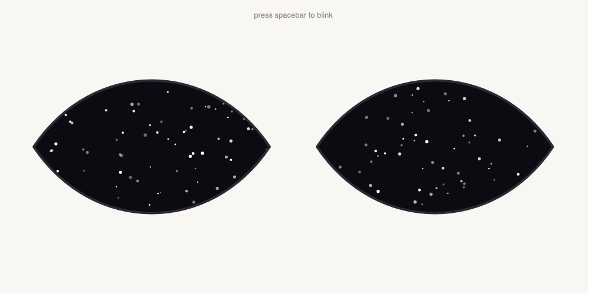
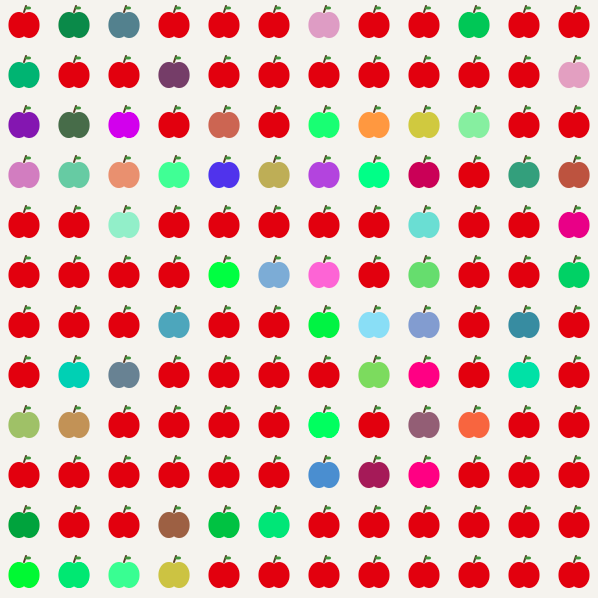
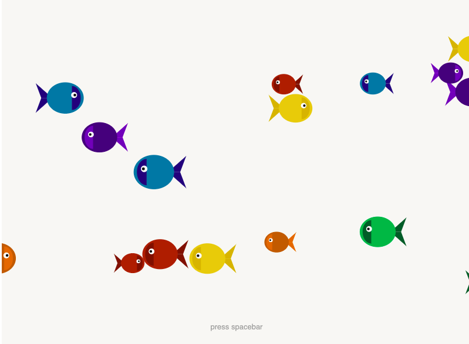

# **Prototyping: Arrays** 
> ## by *Frid Wright* 06/11/2026

## Objectives
1. Getting used to the syntax of arrays
2. Using arrays to include more elements in a single program
3. Using arrays to store data for display or manipulation in a problem

## Deliverables

### 1. Prototype One - Night Adaptation  [view here](https://fridwright.github.io/cart253/topics/prototyping-arrays/adaptation/)

### 2. Prototype Two - Apples [view here](https://fridwright.github.io/cart253/topics/prototyping-arrays/apples/)

### 3. Prototype Three - Aquarium [view here](https://fridwright.github.io/cart253/topics/prototyping-functions/aquarium/)

> ## Link to Reflective Journal: 📚[click here](journal.md)