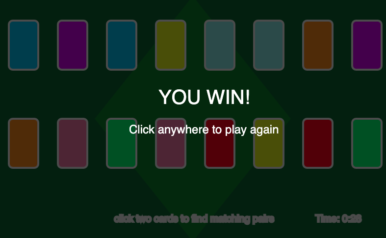
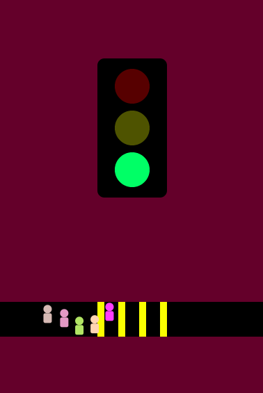
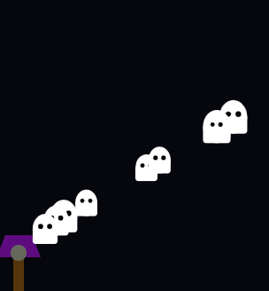

# **Prototyping: Events** 
> ## by *Frid Wright* 21/10/2026

## Objectives
1. Get comfortable with events and the idea of your program responding to external input
2. Experimenting with the different kinds of events available (and reading the documentation)
3. Experimenting with what new experiences your program can create through events

## Deliverables

### 1. Prototype One - Timed Match Game (rework of previous project) [view here](https://fridwright.github.io/cart253/topics/prototyping-events/timed-match-game/)

### 2. Prototype Two - Crosswalk [view here](https://fridwright.github.io/cart253/topics/prototyping-conditionals/crosswalk/)

### 3. Prototype Three - Ghosts [view here](https://fridwright.github.io/cart253/topics/prototyping-conditionals/ghosts/)

> ## Link to Reflective Journal: 📚[click here](journal.md)