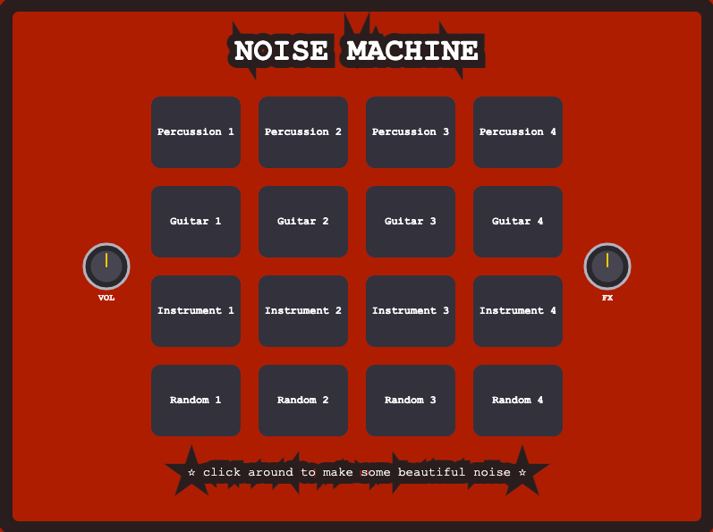
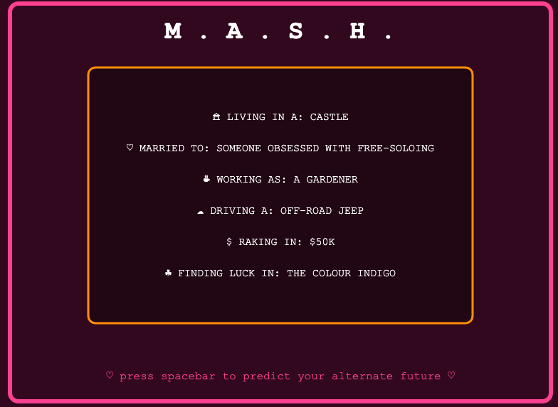
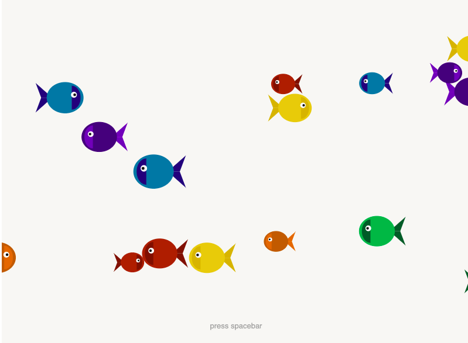

# **Prototyping: Functions** 
> ## by *Frid Wright* 30/10/2026

## Objectives
1. Writing more organized and clear programs by using functions
2. Leveraging parameters and return values to unlock new scales of programming

## Deliverables

### 1. Prototype One - Noise Machine  [view here](https://fridwright.github.io/cart253/topics/prototyping-functions/noisemachine/)

### 2. Prototype Two - M.A.S.H. [view here](https://fridwright.github.io/cart253/topics/prototyping-functions/mash/)

### 3. Prototype Three - Aquarium [view here](https://fridwright.github.io/cart253/topics/prototyping-functions/aquarium/)

> ## Link to Reflective Journal: 📚[click here](journal.md)